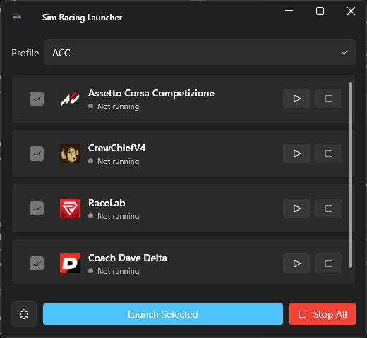
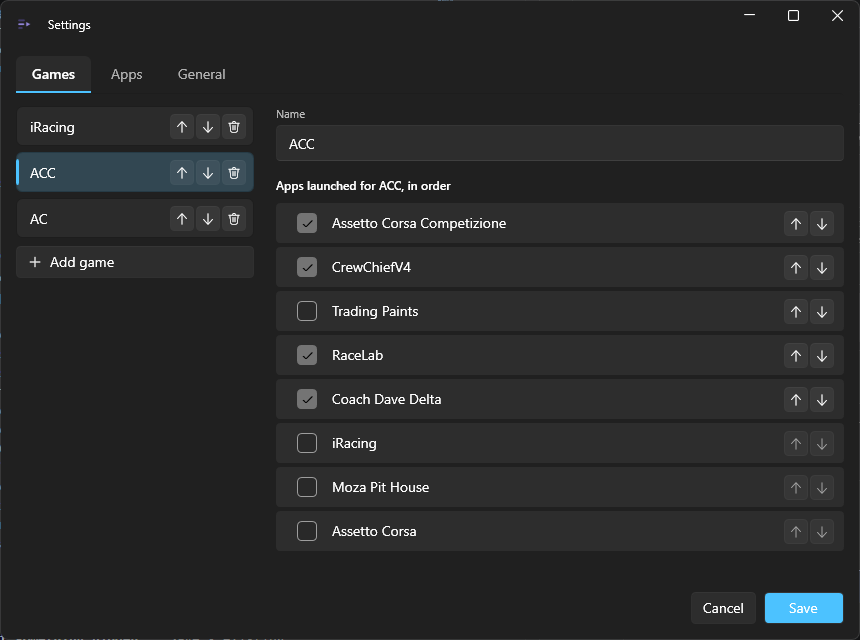

<p align="center">
  
  
</p>

A small Windows app that starts your whole sim racing setup in one click:
the sim you're running (iRacing, ACC, Assetto Corsa, Le Mans Ultimate or
anything else) plus the companion apps that go with it, like voice coaching,
paint downloaders and telemetry overlays. No hunting for shortcuts, and
nothing gets launched twice.

Extended off a simple launcher SwizzleShizzle made.

**[Download the latest release](https://github.com/Fluffy-Swizzle-Interactive/sim-racing-launcher/releases/latest)**
· [What's new](CHANGELOG.md)

<p align="center">
  
  
</p>

## Features

- **One click for everything.** Pick a game, hit **Launch Selected**, and
  its apps start one after another with a short delay between them. Apps
  that are already running are skipped.
- **Set up each app once.** Crew Chief, Trading Paints, RaceLab and the rest
  are configured in one place and shared by every game. Each game ticks the
  apps it uses and sets their order.
- **A setup per game.** Switch games from the dropdown on the main window
  (labelled **Profile**). Ships with iRacing, ACC and AC ready to go.
- **Steam games and VR.** Give a game its Steam App ID and it launches
  through Steam; tick **Launch in VR** to start it in Steam's VR mode. Pick
  a game's exe from a Steam library and the App ID fills itself in.
- **Launch arguments** for any app that needs extra command-line options.
- **Live status.** Each app shows whether it's running, not running or
  can't be found, and updates by itself.
- **Start, stop, or Stop All.** Start or stop any single app, or stop
  everything at once (this also halts a launch that's still going).
- **Find apps for you.** **Auto-Find** searches the usual install folders
  for an app, or **Browse** to pick the `.exe` yourself.
- **Close to tray** (optional), launch at Windows startup (optional), and a
  light or dark theme.

## Setup guide

1. **Run the launcher.** The first time, it comes with three games
   (**iRacing**, **ACC** and **AC**) and a list of common apps with their
   names filled in but no paths, since every PC installs things somewhere
   different.
2. **Open Settings** with the gear icon at the bottom left. It has three
   tabs: **Games**, **Apps** and **General**.
3. **Point each app at its program, on the Apps tab.** Pick an app in the
   list, then click **Auto-Find** to search for it or **Browse** to pick the
   `.exe` yourself. You only do this once per app, and it applies to every
   game that uses it. To add another tool, click **Add app** and fill in:
   - **Name**: whatever you want to call it.
   - **Process name**: the program's file name without `.exe`. The launcher
     uses it to tell whether the app is already running.
   - **Path**: where the program is.
   - **Launch arguments** (optional): extra command-line options.
4. **Steam games and VR.** If the path you pick is inside a Steam library,
   the **Steam App ID** fills itself in and the game will launch through
   Steam. You can also type it yourself: it's the number in the game's Steam
   store URL, like `2399420` for Le Mans Ultimate.
   - Tick **Launch in VR** to start the game in Steam's VR mode. Some sims,
     like iRacing, turn VR on inside the game instead, so leave it unticked
     for those.
   - Keep the **process name** set to the game's own program, not Steam.
   - Extra launch options for a Steam game go in Steam itself (right-click
     the game, then Properties, Launch Options). The launcher's arguments
     box is turned off for Steam games.
   - The ID isn't filled in automatically for apps that have launch
     arguments, or for Assetto Corsa's Content Manager, which should keep
     launching directly. Press **Find ID** if you want it anyway, or clear
     the ID to go back to launching the program directly.
5. **Choose each game's apps, on the Games tab.** Pick a game, tick the apps
   it uses, and set their launch order with the up and down arrows.
   Unticking an app here only affects that game. Deleting an app on the
   **Apps** tab removes it from every game.
6. **Add or remove games** on the Games tab with **Add game** and the delete
   button. You always need at least one.
7. **Save.** Back on the main window, pick a game from the **Profile**
   dropdown and hit **Launch Selected**, or start and stop apps one at a time
   with the buttons on each row. Untick an app on the main window to leave
   it out; it disappears from the list until you tick it again for that game
   in Settings.
8. **Optional, on the General tab:** change the delay between launches, start
   the launcher with Windows, or turn on **Close to tray** so the X button
   hides the window to the tray instead of quitting (use the tray icon's
   **Exit** to quit). The tray icon's menu can also **Launch Selected**.

## Requirements

- Windows 10 or 11 (64-bit).
- Nothing else. The download includes everything it needs, including the
  .NET runtime.

## Building from source

Requires the [.NET 10 SDK](https://dotnet.microsoft.com/download).

```bash
dotnet build
dotnet test
```

To produce a standalone, self-contained `.exe`:

```bash
dotnet publish src/iRacingLauncher/iRacingLauncher.csproj -c Release
```

The published executable will be under
`src/iRacingLauncher/bin/Release/net10.0-windows/win-x64/publish/`.

## Making a release

1. Add a `## vX.Y.Z` section to [CHANGELOG.md](CHANGELOG.md) describing the
   release, and merge everything to `master`.
2. Tag the commit and push the tag:

   ```bash
   git tag v1.1.0
   git push origin v1.1.0
   ```

The `build-and-sign` workflow then runs the tests, builds `SimRacingLauncher.exe`
stamped with that version, and creates the GitHub Release with the changelog
section as its notes and the exe attached (the signed one once code signing is
set up). The build fails, and no release is made, if the changelog has no
section for that version.

## Tech stack

.NET 10, WPF, and [WPF-UI](https://github.com/lepoco/wpfui) for the Fluent
Design interface.

## Code signing

Releases aren't code-signed yet, which is why Windows shows a SmartScreen
warning on first run. This project is applying for free code signing
through the [SignPath Foundation](https://signpath.org) for open-source
projects. A GitHub Actions workflow
(`.github/workflows/build-and-sign.yml`) is already wired up for it; once
the application is approved, finish the setup by:

1. Creating a project in the SignPath dashboard and a signing policy
   named `release-signing` (and optionally `test-signing` for non-release
   builds).
2. Adding `SIGNPATH_API_TOKEN` as a repo secret and
   `SIGNPATH_ORGANIZATION_ID` as a repo variable
   (Settings, then Secrets and variables, then Actions).

The workflow signs automatically from there; nothing else to change.

## Privacy

This app makes no network requests and collects no data of any kind. All it
does is start and stop the apps you set up, open Steam links for Steam
games, and read and write its own local settings file.

## License

[MIT](LICENSE)
